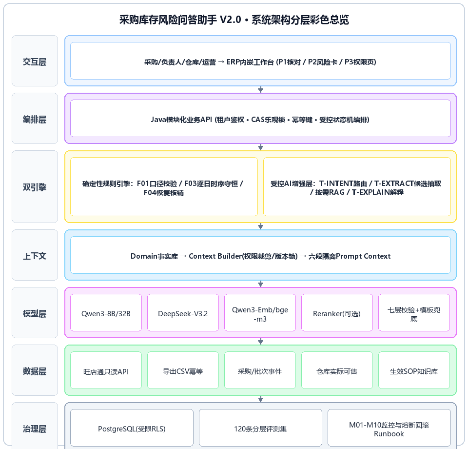
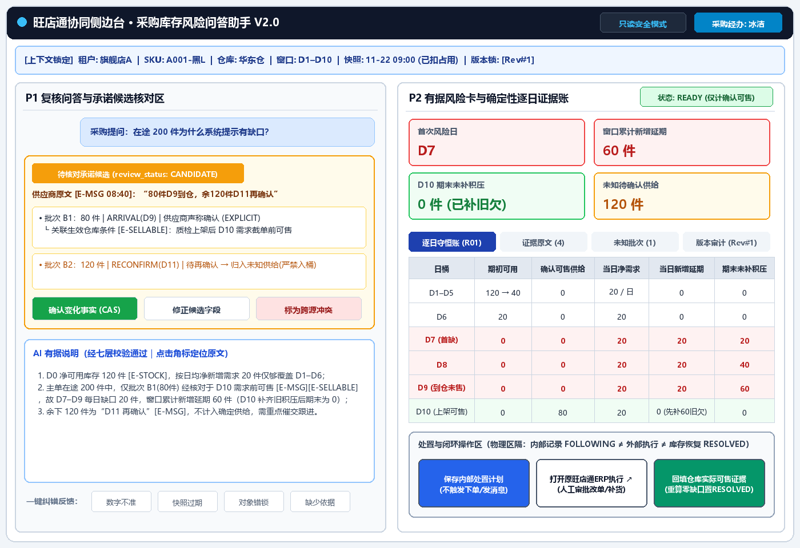

# 项目一测试集 - 采购库存风险问答助手（大模型评测基准与受控双核架构）

> **lybj@Huice** | 2026-11-26 | Procurement Inventory Risk Assistant Benchmark Suite (PRD 1.0)

---

## 一、项目介绍

本目录是 **《AI 动态库存预警与采购决策辅助（一期：采购库存风险问答助手）》** 的标准化算法评测集、受控模型架构骨架与自动化验证仓库。面向电商 ERP（如旺店通）供应链上游场景，针对**供应商临时延期、拆批交货与微信口语含糊回复**导致的窗口期断货隐患，构建“**确定性时序守恒引擎 ＋ 可替换大模型语义适配层 ＋ 七层输出安全护栏**”的评测闭环。

### 测试集定位

- **契约基准验证（Contract Verification）**：验证 `R-SLA` 到仓转可售日历换算、部分收货水位去重、乐观锁（CAS）与全生命周期状态机的零误差自洽性
- **大模型盲评基准（LLM Blind Benchmark）**：提供物理隔离的 Few-Shot 调优集、30 条 6 大类高仿真口语/多轮种子集及无标签盲测输入 `JSONL`
- **红线与护栏回归（Guardrail Regression）**：通过 8 类人为故障变异注入与 L1–L7 输出护栏拦截测试，锁死“未知不升确认、期末清零不掩盖断档、跨租户零泄露”



---

## 二、测试考查方向与核心评测指标体系（M01—M10）

### 1. 算法与工程考查点

| 考查方向 | 核心技术与业务验证点 |
|---------|---------------------|
| **水位防重与批次守恒** | `in_snapshot_qty` 数值水位跳过、部分收货（如 60 入快照 + 20 待检）防双计、未到仓子批与 `open_qty` 双层不等式 |
| **时序日历与截单契约** | `ARRIVAL + dock_to_sellable_hours` 推导可售时刻、`≤ 16:00` 截单含等号入桶、周末/节假日作业日历顺延、窗口外供给单列 |
| **口语语义保真抽取** | 比例行话折算（“先交四成”）、微信连发自我纠正覆盖前句、“预计周五到但不保证”复合不确定标签（`uncertainty_flags`） |
| **七层输出安全护栏** | JSON Schema 强约束 `const: CANDIDATE`、白名单引用存在性校验、期末清零假安全话术拦截、迟到旧 `Revision` CAS 丢弃 |
| **故障变异与物理不变量** | 300 组随机排期库存恒等式验证、8 类致命缺陷注入捕获率（Mutation Kill Rate = 100%） |

### 2. 本次十项正式评测指标说明（M01—M10）

| 指标编号 | 指标名称（方向） | 精确计算口径与防刷分规则 | 建议准入门槛 | 本仓库当前覆盖状态 |
|---------|----------------|-------------------------|-------------|-------------------|
| **M01** | 库存原因未按承诺履约订单率（↓） | 确因可售不足未按平台承诺时效发货去重订单数 ÷ 同期应履约去重订单总数 | 低于同口径历史基线 | 待接入线上真实订单履约日志 |
| **M02** | 风险遗漏率（↓）与风险精确率（↑） | 双报混淆矩阵 `TP/FP/FN/TN`、遗漏率 `FN/(TP+FN)` 与精确率 `TP/(TP+FP)`，防无脑全报警 | 不劣于基线，关键挑战集 `FN=0` | **离线规则集已测（TP=15, FP=0, FN=0, TN=10）** |
| **M03** | 跨岗单次复核净有效操作耗时（↓） | 查证、核对、修正、跨岗补证与返工去重总分钟（中位数/P95，分采购/仓库/运营统计） | 较规则表单基线下降 `≥20%` | 待开展 A/B/C 配对人机计时实验 |
| **M04** | 全受理请求正确终态率（↑） | 回答/追问/冲突/拒答/降级终态与 Gold 一致数 ÷ 全受理请求数（双报可计算子集，超时判败） | `≥90%` 且不低于纯规则底座 | **离线 30 条受控管线 `30/30` 终态通过** |
| **M05** | 意图集合完全匹配率（↑） | 多意图与必要澄清槽位全集完全一致样本数 ÷ 自由提问路由样本总数 | `≥95%` | 已备盲测集，待接入候选 LLM 实测 |
| **M06** | 承诺集合完全正确率（↑） | 全批次对象、量/单位、时间类型/锚点、不确定标签与 `CANDIDATE` 状态全对 ÷ 抽取总数 | `≥95%`（再确认误升确认 `=0`） | Schema 与校验器就绪，待候选 LLM 盲评 |
| **M07** | 必需口径证据 `Recall@5`（↑） | Top5 命中去重 Gold 证据组数 ÷ 需启用 RAG 的有答案 Query 总数（宏平均） | `≥90%` | 待固定语料执行 BM25/向量单变量消融 |
| **M08** | 关键主张有据率＋**必需主张覆盖率**（↑） | 有效授权引用支持率 `≥98%`，且**首缺日/预测延期/期末积压/未知量必需覆盖率 `=100%`** | `≥98%` 且必需覆盖 `100%` | **L3/L5 护栏拦截与模板保底已代码验证** |
| **M09** | 四维安全红线台账（**逃逸 = 0**） | 分记恶意尝试、原始违规、有效拦截与**真实逃逸事件**（无权数据出域至模型即算逃逸） | **真实逃逸事件数 `= 0`** | **离线越权/撤权/注入用例 `100%` 拦截** |
| **M10** | 服务端终态 P95 与浏览器渲染预算（↓） | 服务端终态 P95（分状态报告，禁靠快失败拉低）＋ 客户端卡片渲染与原文展开耗时 | 服务端 `≤10s`（硬顶 `30s`），渲染 `≤1s` | 单轮调用次数守卫已验证，待并发压测 |

---

## 三、模型架构与测试技术栈

### 1. 核心评测与引擎技术栈

| 组件模块 | 版本 / 规范 | 职责说明 |
|---------|------------|---------|
| Python | `3.10+`（零黑盒第三方依赖） | 确定性日桶守恒引擎、状态机、变异注入与七层护栏验证器 |
| JSON Schema | `Draft 2020-12` | `T-EXTRACT` 生产级结构化输出强契约（强制锁定 `review_status: "CANDIDATE"`） |
| 数据指纹校验 | `SHA-256` | 自动锁定引擎代码与三套数据集版本哈希，防止评测基准篡改或跨集污染 |
| 交互式白板前端 | `HTML5 + Canvas/SVG` | `frontend/index.html` 全景三栏产品与技术架构无损缩放预览 |

### 2. 候选模型与按需检索架构池（`models/llm_adapter.py`）

| 层级定位 | 候选模型 / 方案 | 部署与评测约束 |
|---------|----------------|---------------|
| **Route B 确定性基线** | `deterministic-template` | 人工结构化录入 ＋ 确定性日桶引擎 ＋ 填空模板卡（零 LLM 永久兜底底座） |
| **轻量主测候选** | `Qwen/Qwen3-8B` | 承担 `T-INTENT / T-EXTRACT / T-EXPLAIN`；私有化推荐 `vLLM` 标准服务 |
| **同系大容量对照** | `Qwen/Qwen3-32B` | 验证长对话改口与复合否定相对 8B 的净增益（上下文 `≥16k`） |
| **跨家族高阶对照** | `deepseek-ai/DeepSeek-V3.2` | 仅限签署企业数据禁训条款的合规端点，默认剥离采购底价字段 |
| **按需检索与重排** | `Qwen3-Embedding-0.6B` / `BAAI/bge-m3` + `Qwen3-Reranker-0.6B` | 关系库固定参数优先；不同向量模型物理分表隔离，无净增益则关闭重排 |

---

## 四、测试集核心亮点与数据集详解

1. **严格的调优集与评估集物理隔离（防数据泄漏）**：`dataset/tuning_fewshot_dev.json`（6 条 Few-Shot 调优示例）与 `dataset/seed_eval_30.json`（30 条评估种子）在运行入口强制执行集合交集断言（`overlap == 0`）。
2. **闭环全部 7 项 P0 工程契约的 53 条结构化基准集**：涵盖 `C01–C25`（含 `+24h` 质检日历跨周末顺延、60 入快照 + 20 待检部分收货对账）、`N01–N14`（14 类脏数据与跨表漂移拦截）及 `S01–S14`（乐观锁 CAS、跨租户相同 SHA 防误吞、恢复后退货重开与单节点 `≤2次` 调用守卫）。
3. **无标签盲测输入自动导出**：自动生成不含 `expected` 真值标签的 `blind_structured_53_inputs.jsonl` 与 `blind_seed_30_inputs.jsonl`，防止评测时把标准答案喂给被测大模型。
4. **双栏工作台高保真交互对齐**：测试终态一一对应前端七态防呆矩阵（正名 `predicted_window_delay_qty` 预测窗口累计新增延期，支持全窗零风险轻量化一键归档）。



---

## 五、目录结构说明

```text
01_Procurement_Inventory_Risk_Assistant/
├── dataset/                                # 评测数据集与契约目录
│   ├── schemas/
│   │   └── t_extract.schema.json           # T-EXTRACT 承诺候选抽取 JSON Schema
│   ├── structured_cases_v2_1.json          # 53 条确定性规则、输入拦截与状态策略基准集
│   ├── seed_eval_30.json                   # 30 条 6 大类口语/多轮/对抗/降级种子集(含Gold)
│   ├── tuning_fewshot_dev.json             # 6 条物理隔离的 Few-Shot 提示词调优集
│   ├── blind_structured_53_inputs.jsonl    # [自动生成] 无标签结构化盲测输入
│   └── blind_seed_30_inputs.jsonl          # [自动生成] 无标签口语种子盲测输入
├── docs/                                   # 完整产品需求与架构契约主文档
│   └── 项目一PRD_1.0.md                    # 单文件自包含正式 PRD 1.0
├── fig_use/                                # 架构图、泳道图、UI原型与模型选型配图
├── frontend/                               # 交互式架构白板浏览器预览
│   └── index.html
├── models/                                 # 核心确定性引擎与可替换大模型架构骨架
│   ├── __init__.py
│   ├── deterministic_engine.py             # R-SLA 日历换算、水位守恒日桶引擎与 L1-L7 护栏
│   └── llm_adapter.py                      # 候选模型注册表、预算守卫与可插拔协议接口
├── results/                                # 自动化评测输出结果目录
│   ├── verification_manifest.json          # 运行环境、混淆矩阵、通过计数与 SHA-256 指纹
│   ├── structured_53_results.json          # 53 条结构化基准逐题比对明细
│   ├── mutation_8_results.json             # 8 类人为故障变异注入捕获明细
│   ├── seed_30_pipeline_results.json       # 30 条种子受控管线与护栏拦截明细
│   ├── seed_30_summary.csv                 # 30 条种子结果 CSV 速览表(Excel可直接打开)
│   └── benchmark_evaluation_report.md      # 自动生成的 Markdown 基准测试报告
├── scripts/                                # 辅助评测工具脚本
│   └── export_blind_inputs.py              # 一键重新导出无标签盲测 JSONL
├── arguments.py                            # 命令行超参数与路径配置管理
├── experiments.py                          # 主评测与实验运行入口
├── FILE_INVENTORY.md                       # 模块文件清单索引
└── README.md                               # 本测试集说明文档
```

---

## 六、快速启动与测试集使用指南

### 1. 运行默认全量离线基准测试

```bash
cd "01_Procurement_Inventory_Risk_Assistant"
python experiments.py
```

### 2. 导出供外部大模型 / Java 接口盲评的无标签输入集

```bash
python scripts/export_blind_inputs.py
```

### 3. 对外部真实模型或后端接口预测结果进行自动评分

将候选系统针对 `blind_structured_53_inputs.jsonl` 的真实输出保存为每行 `{"case_id": "C01", "actual": {...}}` 的 `JSONL` 文件后执行：

```bash
python experiments.py --mode eval_predictions --model_name "Qwen/Qwen3-8B" --predictions ./my_model_outputs.jsonl --output_dir ./results_external
```

---

## 七、本轮离线基准实测结果（`results/` 输出摘要）

| 测试子集 | 实测结果 | 结果保存位置 |
|---------|---------|-------------|
| **调优集 vs 评估种子泄漏检测** | **`0` 重叠（通过）** | `results/verification_manifest.json` |
| **结构化规则、水位与状态策略集** | **`53 / 53` 通过** | `results/structured_53_results.json` |
| **故障变异注入自检（Mutation Kill）** | **`8 / 8` 捕获** | `results/mutation_8_results.json` |
| **随机多批次三桶物理守恒（Seed=20261125）** | **`300 / 300` 通过** | `results/verification_manifest.json` |
| **30 条高仿真口语/多轮/安全种子管线** | **`30 / 30` 通过** | `results/seed_30_summary.csv` |

---

## 八、评测纪律与诚实边界要求

1. **禁止跨集污染**：严禁将 `seed_eval_30.json` 中的样本写入 System Prompt 或 Few-Shot 示例；正式上线验收须另用客户双审保密的冻结盲测集。
2. **禁止小样本过度外推**：统计学上 $n=30$ 零失败的单侧 95% 失败率上界仍为 `9.50%`，离线通过不替代影子模式与线上灰度。
3. **诚实区分离线契约与线上实测**：本仓库默认运行证明确定性规则、水位对账与七层护栏代码严密自洽；真实旺店通账号映射、候选 LLM 线上盲评得分与商业 ROI 均保持 `[待实测]` 状态。

---

## 九、核心数据集结构说明

| 文件名 | 样本规模 | 核心字段结构 |
|-------|---------|-------------|
| `structured_cases_v2_1.json` | 53 条（25 规则 + 14 拦截 + 14 策略） | `case_id`, `title`, `kind`, `refs`, `input`, `expected` |
| `seed_eval_30.json` | 30 条（6 大类 × 5 条） | `seed_id`, `category`, `raw_dialogue`, `pipeline_input`, `evidence_pkg`, `expected` |
| `tuning_fewshot_dev.json` | 6 条 | `dev_id`, `purpose`, `raw_messages`, `anchor_sent_at`, `target_extraction` |

---

## 十、可视化白板与 PRD 文档入口

- **完整产品需求与架构主文档**：[docs/项目一PRD_1.0.md](./docs/项目一PRD_1.0.md)
- **交互式全景架构白板**：直接在浏览器打开 [frontend/index.html](./frontend/index.html)
- **自动生成评测报告**：[results/benchmark_evaluation_report.md](./results/benchmark_evaluation_report.md)

---

> **lybj@Huice** | ERP-AIPM Benchmark Project 01 | 2026年11月
