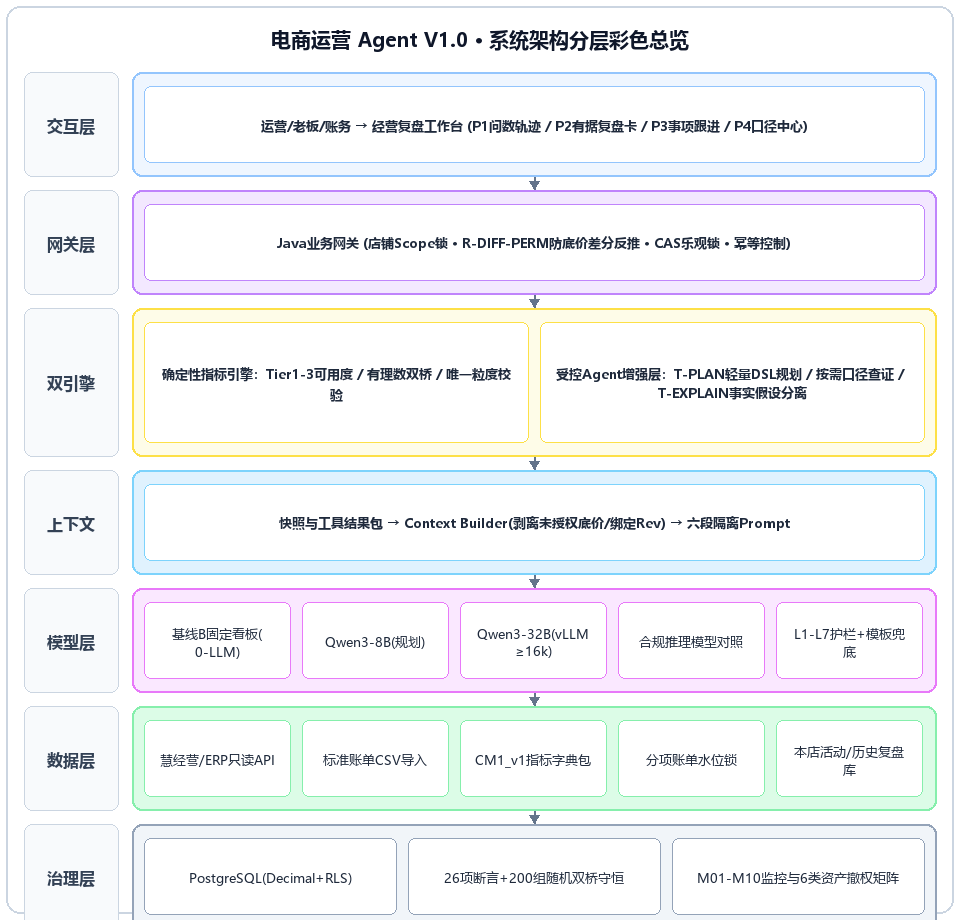
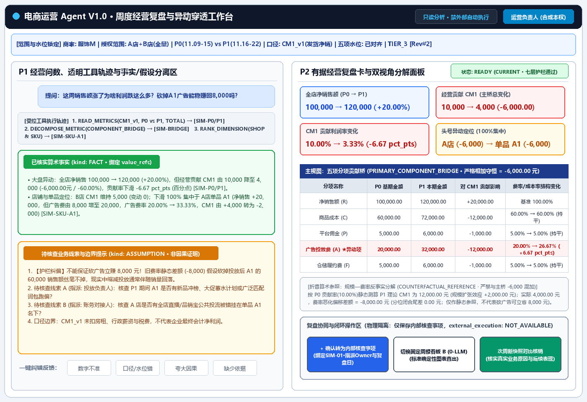

# 项目二测试集 - 电商运营Agent（大模型问数归因评测基准与受控指标架构）

> **lybj@Huice** | 2026-11-26 | E-commerce Operations Agent Benchmark Suite (PRD V1.0)

---

## 一、项目介绍

本目录是 **《电商运营Agent（一期：经营问数、异动穿透、周度复盘与核查跟进）》** 的标准化算法评测集、分层模型架构骨架与自动化验证仓库。面向电商 ERP（旺店通/慧策生态）经营下游场景，针对多店铺、多 SKU 周度复盘中**“销售额增长但经营贡献利润 CM1 下降”**等典型异动，构建“**白名单受控指标服务（轻量 Text2DSL）＋ 精确有理数双分解桥引擎 ＋ 事实/假设分离七层护栏**”的完整评测体系。

### 测试集定位

- **业财指标与权限底座验证**：验证 `TIER_1~3` 三级指标可用度门禁、店铺公共推广费防粗暴均摊（`R-ALLOC`）、跨表账单水位锁（`R-WATERMARK`）与无拿货底价权限防差分反推（`R-DIFF-PERM`）
- **精确双视角财务分解验证**：基于精确有理数（`fractions.Fraction`）验证五项分项贡献桥与规模—费率反事实参照在任意随机账面金额下 100% 守恒零尾差漏洞
- **Agent 规划与解释盲评基准**：提供 `T-PLAN` 与 `T-EXPLAIN` 生产级 JSON Schema、物理隔离调优集及 30 条 6 大类高仿真电商运营种子集（`OPS-01`–`OPS-30`）



---

## 二、测试考查方向与核心评测指标体系（M01—M10）

### 1. 算法与工程考查点

| 考查方向 | 核心技术与业务验证点 |
|---------|---------------------|
| **三级可用度与防粗暴均摊** | 缺广告账单时放行净销售但阻断 `CM1`（防空值补零）；全店公共推广费无 SKU 明细时阻断 SKU 级 `CM1` 强拆，降级展示 SKU 毛利＋店级投放 |
| **有理数双分解桥守恒** | 主分项桥（`-6,000`）与旧利润率静态反事实差额（`-8,000`）物理分槽隔离，分位四舍五入尾差 `rounding_residual` 显式闭合 |
| **敏感底价防差分反推** | 无 `COGS` 底价权限角色同步封锁 `CM1 / GROSS_MARGIN`，堵死利用 `销售额 - 已知费用 - CM1` 减法反推拿货成本的泄密通道 |
| **范围诚实与账单水位锁** | 仅获 A 店授权问“全公司”直接阻断防静默裁剪；拦截订单准实时与千川/直通车账单 `T+1` 滞后的跨表错位相减 |
| **统计分解与业务因果隔离** | L5/L6 输出护栏强制区分算术事实（`FACT`）与待核查业务线索（`ASSUMPTION`），严厉拦截“砍掉广告立赚 8,000 元”等伪因果承诺 |

### 2. 本次十项正式评测指标说明（M01—M10）

| 指标编号 | 指标名称（方向） | 精确计算口径与防刷分规则 | 建议准入门槛 | 本仓库当前覆盖状态 |
|---------|----------------|-------------------------|-------------|-------------------|
| **M01** | 全可标注任务正确终态率（↑） | 准确回答/精准追问/权限阻断/覆盖降级与 Gold 一致数 ÷ 全可标注受理任务数（双报可计算子集） | `≥90%` 且不低于固定看板基线 B | **离线 30 条运营种子管线 `30/30` 终态通过** |
| **M02** | 跨岗单次复盘净有效操作耗时（↓） | 导表核对、阅读修正、异常接手与跨岗确认去重总分钟（中位数/P95，分运营/账务/老板统计） | 较固定看板 B 下降 `≥20%` | 待开展 A/B/C1/C2 配对周报计时实验 |
| **M03** | 查询语义与范围槽位全对率（↑） | 指标编码、授权店铺、可比期间、同进度对齐模式、粒度与必要澄清全对 ÷ 语义样本总数 | `≥95%` | Schema 与盲测集就绪，待候选 LLM 实测 |
| **M04** | 关键经营事实全对率（↑） | 核心金额、正负号、增长率 `%`、**比率百分点 `pct_pts`**、分项桥与限制全对 ÷ 可评事实任务数 | `≥95%`（双桥混加错误 `=0`） | **离线确定性双桥与精度集 `100%` 验证通过** |
| **M05** | 主张有据率＋**必需核心主张覆盖率**（↑） | 有效 `result_refs` 支持率 `≥98%`，且**总变动/异动店品/覆盖限制/非因果说明覆盖率 `=100%`** | `≥98%` 且必需覆盖 `100%` | **L3/L5/L6 护栏拦截与模板回退已代码验证** |
| **M06** | 受控工具任务轨迹全对率（↑） | 调用白名单工具名、参数边界、先后依赖、停止时机与轮次预算全合规任务数 ÷ 工具评测总数 | `≥95%` | 工具契约与预算守卫已定义，待模型实测 |
| **M07** | 适用口径证据 `Recall@5`（↑） | Top5 命中去重 Gold 证据组数 ÷ 确需启用 RAG 的有答案口径 Query 总数（未启用标 `N/A`） | `≥90%`（停用时标 `N/A`） | 待复杂制度文档场景单变量消融实测 |
| **M08** | 四维安全红线台账（**逃逸 = 0**） | 分记尝试、原始违规、有效拦截与**真实逃逸**（无权店铺或无权 `COGS` 拼入模型出域即算逃逸） | **真实逃逸事件数 `= 0`** | **防差分反推/防静默裁剪/CAS 离线 `100%` 拦截** |
| **M09** | 分终态服务端 P95 与浏览器渲染预算（↓） | 服务端终态 P95（分状态汇报）＋ 浏览器卡片渲染与证据展开耗时 | 服务端 `≤15s`（硬顶 `30s`），渲染 `≤1s` | 待接入 `vLLM` 推理服务与浏览器压测 |
| **M10** | 单正确完成任务全口径总成本（↓） | 同周期（Token 含重试＋算力存储＋接入维护＋人审复核成本）÷ 正确完成任务总数 | 低于批准单任务成本红线 | 待结合真实 Token 账单与复核工时核算 |

---

## 三、模型架构与测试技术栈

### 1. 核心评测与指标引擎技术栈

| 组件模块 | 版本 / 规范 | 职责说明 |
|---------|------------|---------|
| Python | `3.10+`（`decimal` + `fractions` 精确算术） | 受控指标查询、三级可用度门禁、精确有理数双桥分解与 L1–L7 护栏验证 |
| JSON Schema | `Draft 2020-12` | `t_plan.schema.json`（受控工具规划）与 `t_explain.schema.json`（事实/假设分离解释） |
| 数据指纹校验 | `SHA-256` | 锁定 `SIM-01` 基准快照、引擎代码与 Schema 契约指纹 |
| 交互式白板前端 | `HTML5 + Canvas/SVG` | `frontend/index.html` 全景三栏产品与技术白板无损缩放预览 |

### 2. 分层候选模型架构（借鉴行业双模型分工最佳实践，`models/llm_adapter.py`）

| 角色层级 | 候选方案 / 模型 | 技术与私有化部署硬约束 |
|---------|----------------|-----------------------|
| **Route B 确定性基线** | `fixed-dashboard-template` | 零 LLM 固定周度复盘看板 ＋ 标准五项分项桥模板（占日常固定看数 70%+，亚秒级响应） |
| **高频轻量规划层（`T-PLAN`）** | `Qwen/Qwen3-8B` | 负责口语范围消歧与白名单工具 DSL 映射；单轮工具调用上限 `≤6次` |
| **深度异动解读层（`T-EXPLAIN`）** | `Qwen/Qwen3-32B` / 合规托管推理模型 | 负责多步追加下钻（`≤2轮`）与事实/假设总结；**私有化强制采用 `vLLM`（禁用 `Ollama` 防 System Prompt 丢失），上下文 `≥16k`** |

---

## 四、测试集核心亮点与数据集详解

1. **贯穿案例 `SIM-01` 双视角精确守恒**：完整复现两店四 SKU“净销售 `+20.00%`（10万→12万），但贡献利润 `CM1` `-60.00%`（10,000→4,000，下滑 `6.67 pct_pts`）”典型异动，精确隔离五项分项桥（`-6,000`）与折叠静态费率参照（`-8,000`）。
2. **6 类高危电商业财故障变异自检（Mutation Testing）**：主动向引擎注入“局部权限静默裁剪冒充全公司”、“允许无底价权限查 CM1 差分泄密”、“忽略跨表账单水位漂移”、“店铺广告按销售额粗暴均摊”、“空缺费用补零虚增利润”、“反事实差额混充主变动” 6 种典型线上缺陷，验证断言 **100% 捕获杀死（`6/6`）**。
3. **30 条 6 大类电商运营种子评估集（`OPS-01`–`OPS-30`）**：全覆盖双桥拆解、账单未齐分级降级、未完结周同进度对齐、因果边界试探、防差分反推权限红线与核查事项幂等闭环。



---

## 五、目录结构说明

```text
02_Ecommerce_Operations_Agent/
├── dataset/                                # 评测数据集与JSON Schema契约目录
│   ├── schemas/
│   │   ├── t_plan.schema.json              # T-PLAN 受控白名单工具规划 JSON Schema
│   │   └── t_explain.schema.json           # T-EXPLAIN 事实/假设分离解释 JSON Schema
│   ├── sim_01_baseline_snapshot.json       # SIM-01 标准两店四品周度经营快照与双桥真值
│   ├── structured_cases_26.json            # 26 条确定性指标、覆盖度、权限与护栏断言集
│   ├── seed_eval_30.json                   # 30 条 6 大类电商运营高仿真种子集(OPS-01..30)
│   ├── tuning_fewshot_dev.json             # 4 条物理隔离的 Few-Shot 调优示例
│   └── blind_ops_seed_30_inputs.jsonl      # [自动生成] 无标签运营提问盲测输入
├── docs/                                   # 正式 PRD 与深度竞品分析报告
│   ├── 项目二PRD_V1.0.md                   # 项目二完整产品需求与架构契约主文档
│   └── 竞品分析-项目二_V1.0.md             # 五大竞品(慧经营/聚胜算/金蝶/观远/帆软)深度报告
├── fig_use/                                # 架构图、泳道图、UI高保真原型与选型配图
├── frontend/                               # 交互式架构白板浏览器预览
│   └── index.html
├── models/                                 # 受控指标双桥引擎与分层大模型架构骨架
│   ├── __init__.py
│   ├── deterministic_engine.py             # Tier1-3门禁、防差分反推、Fraction双桥与L1-L7护栏
│   └── llm_adapter.py                      # 规划/解释双层候选模型注册表与vLLM预算规范
├── results/                                # 自动化评测输出结果目录
│   ├── verification_manifest.json          # 运行环境、通过计数与 SHA-256 版本指纹
│   ├── structured_26_results.json          # 26 条确定性指标与七层护栏逐题明细
│   ├── mutation_6_results.json             # 6 类高危业财变异注入捕获结果
│   ├── seed_30_ops_results.json            # 30 条运营种子评测详细结果
│   ├── seed_30_ops_summary.csv             # 30 条运营种子结果 CSV 汇总表
│   └── benchmark_evaluation_report.md      # 自动生成的 Markdown 基准测试报告
├── scripts/                                # 辅助工具脚本
│   └── export_blind_inputs.py              # 一键重新导出无标签盲测 JSONL
├── arguments.py                            # 命令行超参数与路径配置管理
├── experiments.py                          # 主评测与实验运行入口
├── FILE_INVENTORY.md                       # 模块文件清单索引
└── README.md                               # 本测试集说明文档
```

---

## 六、快速启动与测试集使用指南

### 1. 运行默认全量离线基准测试

```bash
cd "02_Ecommerce_Operations_Agent"
python experiments.py
```

### 2. 导出供候选大模型盲评的无标签提问集

```bash
python scripts/export_blind_inputs.py
```

### 3. 自定义随机种子与指定候选模型架构配置运行

```bash
python experiments.py --planner_model "Qwen/Qwen3-8B" --explainer_model "Qwen/Qwen3-32B" --num_property_runs 500
```

---

## 七、本轮离线基准实测结果（`results/` 输出摘要）

| 测试子集 | 实测结果 | 结果保存位置 |
|---------|---------|-------------|
| **调优集 vs 评估种子泄漏检测** | **`0` 重叠（通过）** | `results/verification_manifest.json` |
| **确定性指标、三级覆盖度、防反推与七层护栏集** | **`26 / 26` 通过** | `results/structured_26_results.json` |
| **高危业财缺陷变异注入自检（Mutation Kill）** | **`6 / 6` 捕获** | `results/mutation_6_results.json` |
| **随机多店多品有理数双桥守恒（Seed=20261125）** | **`200 / 200` 通过** | `results/verification_manifest.json` |
| **30 条电商运营种子受控管线（`OPS-01`–`OPS-30`）** | **`30 / 30` 通过** | `results/seed_30_ops_summary.csv` |

---

## 八、评测纪律与诚实边界要求

1. **严禁混淆统计分解与业务因果**：任何候选模型若在 `FACT` 中将静态费率偏移（`-8,000`）表述为“砍掉广告即可稳赚 8,000 元”，一律判 L6 护栏失败。
2. **严禁将过程核查记为利润兑现**：运营确认或完成 `CheckItem` 内部核查事项仅代表管理动作留痕，绝不自动计入 AI 挽回利润额。
3. **诚实区分离线验证与线上实测**：当前 `results/` 验证了受控指标服务、权限防反推与护栏契约；真实商家多平台账单接入、大模型端到端盲评与 `M02` 净省时待试点实测。

---

## 九、核心数据集与契约文件说明

| 文件名 | 规模 / 类型 | 核心内容 |
|-------|------------|---------|
| `sim_01_baseline_snapshot.json` | 2 期 × 2 店 × 4 SKU | 标准周度经营快照、五项账单水位与双分解桥精确真值 |
| `structured_cases_26.json` | 26 条断言 | `C01–C19` 指标/覆盖度/权限/水位断言 ＋ `G01–G07` 七层解释护栏断言 |
| `seed_eval_30.json` | 30 条（6 大类 × 5 条） | `OPS-01`–`OPS-30` 完整电商运营复盘与边界挑战种子台账 |
| `schemas/t_plan.schema.json` | JSON Schema | 白名单指标工具与期间同进度对齐规划契约 |
| `schemas/t_explain.schema.json` | JSON Schema | `FACT/ASSUMPTION` 分离、`value_refs` 绑定与禁外部执行契约 |

---

## 十、可视化白板与配套报告入口

- **项目二正式 PRD 主文档**：[docs/项目二PRD_V1.0.md](./docs/项目二PRD_V1.0.md)
- **五大竞品深度研究报告**：[docs/竞品分析-项目二_V1.0.md](./docs/竞品分析-项目二_V1.0.md)
- **交互式全景架构白板**：直接在浏览器打开 [frontend/index.html](./frontend/index.html)
- **自动生成评测报告**：[results/benchmark_evaluation_report.md](./results/benchmark_evaluation_report.md)

---

> **lybj@Huice** | ERP-AIPM Benchmark Project 02 | 2026年11月
