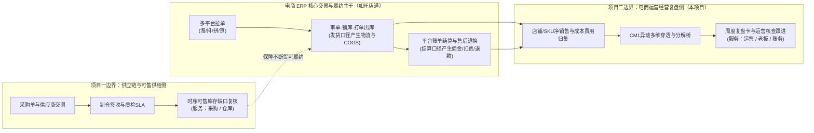
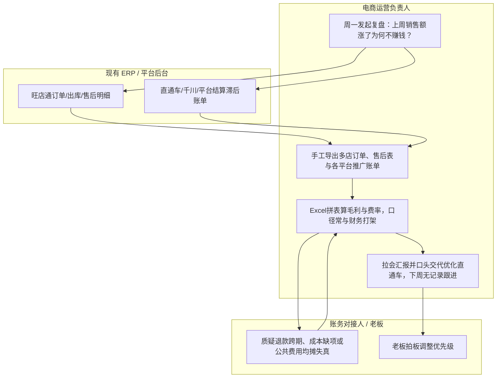
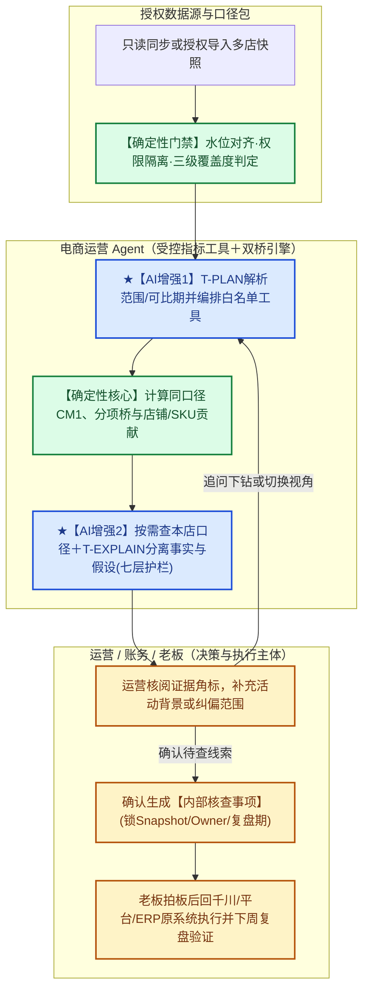

# 竞品分析-项目二 V1.0

| 项目维度 | 核心信息 |
| --- | --- |
| **姓名 / 背景** | 龙玉冰洁｜电商 ERP 打单仓储平台 Java 后端开发（`Smart-Warehouse` 作者） |
| **项目定位** | **项目二：电商运营 Agent**（与项目一《采购库存风险问答助手》同处电商 ERP 核心业务链，但上下游分工独立：项目一聚焦**供应链上游可售库存时序供给**，项目二聚焦**经营下游多店/多品收入、成本、费用归集、利润异动复盘与运营核查跟进**） |
| **核心用户与决策链** | **高频使用人**：中小电商运营负责人/店长；**协同确认人**：现有账务对接人/财务；**购买与拍板人**：商家老板/业务总经理 |
| **一期聚焦切口** | 周度经营复盘与异动穿透（以“销售额增长 20%，但经营贡献利润 CM1 下降 60%”为贯穿验证场景） |
| **调研与检索截止** | 2026-11-25（基于官方产品页、开放平台 API 目录、帮助中心架构文档与带日期版本公告深度检索） |
| **配套主文档** | [项目二PRD V1.0.md](file:///C:/Users/0013QM/.gemini/antigravity/brain/0efb24e6-affc-4327-9509-10910ac0f6ca/%E9%A1%B9%E7%9B%AE%E4%BA%8CPRD%20V1.0.md) |

---

## 报告核心摘要与五级证据约定

### 核心研究结论
1. **“自然语言问数＋图表展示＋异动解读”绝非市场空白**：在电商 ERP 原生侧（**慧策·慧经营/慧数图**、**聚水潭·聚胜算**）、小微业财 SaaS 侧（**金蝶 AI 星辰·老板参谋**）与企业级 Agentic BI 侧（**观远 Data Agent**、**帆软 FineChatBI**）均已形成成熟供给。把“接入大模型查销售额或画折线图”包装成独创卖点在商业评审中完全站不住脚。
2. **电商 ERP 运营分析真正的深水区不在“写 SQL”，而在“业财三大口径鸿沟”**：结合对旺店通 ERP 业务链的深度还原，单纯依靠前端订单/仓储表算不出真实经营贡献利润（CM1）——**① 支付口径 vs 发货出库口径 vs 平台账单结算口径的错位**、**② 跨期售后退款与退货良品入库/残次损耗的成本匹配**、**③ 店铺/计划级投流费用（直通车/巨量千川）向 SKU 级下钻时的分摊失真**，才是导致电商运营“只见流水不见钱、周报对不上财务账”的根本症结。
3. **行业头部技术架构已收敛至“受控指标底座（Text2DSL/白名单工具）＋ 大小/推理模型分层”，否定裸连明细表自由生成 SQL**：帆软 FineChatBI 依托 FineBI 指标中心走 Text2DSL 并将通用小模型与推理大模型（DeepSeek-R1 / Qwen Thinking）分层；观远 Data Agent 强制要求前置构建业务语义清晰的 ADS 宽表与字段注释（Comment）。这直接印证本项目**一期严禁开放任意自由 SQL、坚持受控指标服务与确定性分解桥**的工程正确性。
4. **五方竞品各有明确的能力边界与落地代价**：同生态原生工具（慧经营/聚胜算）业财对账深厚但连续对话拆解与核查跟进闭环待实测；金蝶老板参谋问数体验轻巧但通用进销存账套难原生承接多平台电商复杂投流与发货/结算双轨账；观远与帆软平台能力强大但要求商家配备数据建模/ETL人力准备宽表与指标中心，对缺乏专职数仓团队的中小电商门槛偏高。
5. **项目二的可验证机会切口**：依托既有电商 ERP 数据上下文，提供**“开箱即用的电商标准 CM1 口径包（含数据水位与覆盖度分级门禁）＋ 受控多步异动分解（严格隔离事实分解与业务假设）＋ 运营核查事项版本化复盘闭环”**。必须通过 **A（现状报表+Excel）→ B（统一指标固定分析页）→ C（受控运营 Agent）** 阶梯消融证明净工时与决策质量增量。

### 五级证据严格标注规范
为杜绝把厂商宣传当实测、把未查到当竞品缺失，全文统一使用五类证据徽章：
- **`[官方披露]`**：来自厂商官网、帮助中心文档、开放平台 API 目录、价格配置页或带明确发布日期的官方公告。
- **`[公开文档还原]`**：依据官方操作手册、接口参数与系统架构图还原的产品工作流，不等同于已注册目标账号亲手点击测量。
- **`[本报告分析]`**：基于电商 ERP 工程经验作出的 SWOT、适配代价、架构取舍与风险判断。
- **`[离线模拟对照]`**：基于本项目独立编写并跑通的 Python 精确有理数/Decimal 验证引擎（`26/26` 规则与护栏用例 ＋ `200/200` 随机多店多品守恒验证通过），仅验证确定性底座逻辑。
- **`[待账号实测/询价]`**：涉及目标客户账号开通状态、真实响应毫秒数、真实问数准确率、非公开商务折扣及客户实际 ROI 的事项，一律保留待验证状态，绝不虚构数字。

---

# 一、P0 业务链校准：从电商打单仓储 ERP 到运营经营分析的真实断层

## 1.1 同一电商 ERP 业务链上“项目一”与“项目二”的清晰边界

在旺店通等电商 ERP 体系内，一笔电商生意的完整数据链条横跨前端营销、中端履约与后端业财。本项目（项目二）与前序项目一处于同一企业数据底座的不同业务闭环，**底层鉴权与快照工程架构可复用，但业务域、核心指标、用户角色与验证资产完全独立**：

> **严正防串项纪律**：项目一的库存日桶通过率（`52/52`）、`stockin_time` 入库修改时间陷阱及 Inventory Planner / Netstock 等供应链竞品结论，仅作为团队具备电商 ERP 研发与研究能力的背景背书，**绝不迁移冒充项目二（电商运营 Agent）的指标验证或竞品证据**。

## 1.2 结合旺店通 ERP 深度校准：为什么只有订单和仓储表做不出可靠的运营 Agent？

基于对旺店通企业版/极速版/旗舰版及慧策生态的工程了解与本轮公开接口核验，中小电商运营在日常周度复盘中面临**三大底层数据鸿沟**：

| 核心业财断层 | ERP 底层真实数据机制 `[官方披露 + 工程校准]` | 若运营 Agent 无视该机制直接生成 SQL 查表会发生什么灾难？ | 对《项目二PRD V1.0》的硬约束输入 |
| --- | --- | --- | --- |
| **1. 三大时间与状态口径分裂** | 旺店通生态内同时存在： ① **下单/支付口径**（运营盯大盘实时 GMV 常用，但含未发货及秒退单）； ② **发货出库口径**（对应仓库实际扣减库存产生物流费与发出商品成本 COGS）； ③ **平台结算口径**（支付宝/抖店/微信账单实际打款扣佣金时间，常跨周/跨月）[S01][S03]。 | 用户问“上周 A 店赚了多少钱”，若模型用“支付时间”查收入、用“出库时间”查成本、用“账单结算时间”查平台佣金，三张表分子分母错配，算出的毛利率完全失真。 | F01/F02 必须锁死显式 `accounting_basis`（默认对齐同口径净销售与匹配成本），严禁跨口径混算。 |
| **2. 推广费账单滞后（T+1~T+3）与粒度悬空** | 订单出库在 ERP 内准实时更新，但直通车、万相台、巨量千川等投流花费及平台结算单往往 **T+1 甚至更晚**才同步导入；且品牌广告/全店推广费天然停留在**店铺级或计划级**，无原生订单行/SKU 归属 [S01][S16]。 | ① 周一上午复盘上周，订单到周日 24 点而广告费只到周六，系统误报“周日 ROI 暴涨”； ② 下钻 SKU 利润时若私自按销售额一刀切均摊全店广告费，会冤杀高客单引流款。 | 引入跨分项水位对齐锁 `component_watermarks` 与**三级指标可用度门禁**（广告费仅到店级时阻断 SKU 级 CM1 强算，改报商品毛利＋店级投放单列）。 |
| **3. 跨期退款与退货实物损益错位** | 电商高频发生“上周发货确认收入，本周发生 7 天无理由退货退款”：仅退款不退货不冲回商品成本；退货入库若为良品冲回库存成本，若拆封损坏则转入退货损耗 [S03][S16]。 | 简单拿“当期收款 − 当期退款”算净销售，再按固定毛利率乘算成本，会漏掉仅退款或残次退货造成的双倍亏损；且历史复盘快照会随事后退款漂移。 | 明确冻结 `CM1_v1` 退款与成本冲回规则；历史复盘绑定不可变 `Snapshot`，事后跨期退款追记入新版本对比而非篡改旧账。 |

## 1.3 慧策（旺店通）开放平台慧经营 API 真实核验 `[官方披露]`

本轮对 [慧经营开放平台 API 目录](https://open.wangdian.cn/hjy/open/apidoc) [S03] 的检索确认，慧策在传统订单/仓储接口之外，专门开辟了业财对账与账单接口体系（如宙斯版等对应产品线），核心公开接口方向包括：
- **发货对账查询**：`wdt.hjy.recon.fhdz.summary.query`（查询发货对账汇总）、`wdt.hjy.recon.delivery.details.query`（查询发货对账明细）；
- **售后对账查询**：`wdt.hjy.recon.shdz.summary.query`（查询售后对账汇总）、`wdt.hjy.recon.shtrecondetail.query`（查询售后对账明细）；
- **标准账单与基础档案**：`wdt.hjy.bill.billstandard.query`（原始账单标准查询）及店铺、仓库、收付款单同步接口。
- **关键接入约束 `[本报告分析]`**：① 对接须具备对应产品线开通的 `appkey`、`appsecret` 与卖家 `sid` 签名授权；② **旺店通 3.0 极速版/企业版基础打单账号并不默认附赠慧经营高级业财模块接口权限**。因此项目二必须支持“**路径 A：授权标准 CSV/报表导出校验接入（零接口增购费起步）**”与“**路径 B：已购慧经营/ERP 开放接口只读同步**”双轨进入。

---

# 二、竞品全景识别与五大核心剖析对象确认

## 2.1 电商经营问数与运营复盘市场全景图

围绕中小电商运营“**查清经营数据 → 定位异动根因 → 生成周度复盘 → 跟进优化动作**”的完整任务链，市场玩家可分为四层：

1. **第一层：电商 ERP 同生态/同赛道业财分析工具（业务与数据底座最贴近）**
   - **慧策体系**：**慧经营**（电商精细化财务对账与多口径利润核算）＋ **慧数图**（多平台运营数据可视化看板与角色分析）[S01][S02]。
   - **国内同业直接标杆**：**聚水潭·聚胜算**（打通聚水潭 ERP 的店铺/SKU/直播场次阿米巴利润核算与费用分摊系统）[S16][S17]；跨境赛道同类标杆如**领星 ERP**（亚马逊广告 ROI 穿透与精细化多币种利润表）、**店小秘**（轻量利润核算）。
2. **第二层：小微企业 AI 业财经营问答直接竞品（交互形态与老板视角高度重合）**
   - **金蝶 AI 星辰·老板参谋**：面向小微企业的进销存业财一体 ＋ DeepSeek 驱动的自然语言经营问数、异动诊断与策略建议 [S04][S05]。
3. **第三层：企业级 Agentic BI / ChatBI 通用智能分析平台（技术架构与问数核对标杆）**
   - **观远数据 Data Agent（问数智能体 ＋ 洞察智能体）**：基于 BI 数据集宽表与语义治理的企业级 NL2SQL 问数及跨卡片多步异动归因报告平台 [S06][S07][S15]。
   - **帆软 FineChatBI**（及同集团面向中小电商的云端分析工具**九数云**）：依托 FineBI 指标中心的 Text2DSL 对话式问数、分析思路拆解与推理大模型解读系统 [S09][S14]。
4. **第四层：电商平台侧原生 AI 与传统手工替代品**
   - **平台侧原生工具**：阿里生意参谋 AI / 淘宝问问商家侧、抖音电商罗盘策略助手、京东京言等——优势是掌握平台站内流量转化漏斗（曝光/点击/人群画像），**致命短板是单平台孤岛**：拿不到商家真实进货底价（COGS）、仓库打包履约费及跨平台（淘+抖+拼）合并盈亏账。
   - **传统替代方式**：现有 ERP 固定报表 ＋ 运营手工导出多平台账单用 Excel `VLOOKUP`/透视表拼周报 ＋ 老板微信群追问，或将脱敏表格直接上传至通用大模型网页端（存在口径错算、算术幻觉与商业机密出域三大隐患）。

## 2.2 五大核心深度剖析对象选择理由（较初稿补齐国内同业标杆“聚水潭·聚胜算”）

| 编号与对象 | 竞品类别定位 | 纳入深度剖析的核心理由 | 证据完备度与严禁直接推定的边界 |
| --- | --- | --- | --- |
| **A. 慧经营 ＋ 慧数图** | 同生态原生业财与分析基线 | 目标客群（旺店通商家）最可能已接触或可增购的原生模块，是立项防重复建设的第一参照系 | 已核验官方产品页与开放平台对账接口目录；**严禁推定所有旺店通打单客户均已免费开通或两模块天然零配置打通** |
| **B. 聚水潭·聚胜算** | 国内电商 ERP 同业直接标杆 | 国内电商解决“店铺/SKU/直播间利润核算＋推广费分摊＋阿米巴经营”最成熟的垂直参照（初稿仅提名字未展开，本版深度补齐） | 已检索还原其利润公式、三种退款口径、推广费分摊权重与费用预估单逻辑；对话式 AI Agent 能力未见官方充分披露 |
| **C. 金蝶 AI 星辰·老板参谋** | 小微业财 AI 经营问答对照 | 2026 年明确披露接入 DeepSeek 并支持“销售额涨但利润未涨”连续追问，与本项目贯穿 Case 直接撞车 | 已核验功能公告与公开标准/专业版软件组合示例价；**严禁推定其通用进销存账套可零成本适配多平台电商投流对账** |
| **D. 观远 Data Agent** | 通用 Agentic BI 平台替代（NL2SQL + 洞察） | 官方公开了极为详尽的数据准备（ADS 宽表/Comment）、SQL 透明核对、问数与洞察双 Agent 分工及三级权限文档 | 已深度核验官方技术手册；企业级定制询价与中小电商无专职数仓人员下的真实配置工时待实测 |
| **E. 帆软 FineChatBI** | 指标底座型 ChatBI 平台替代（Text2DSL + 推理分层） | 官方架构文档清晰揭示了“指标中心语义层 ＋ Text2DSL ＋ 小模型与推理大模型分工 ＋ vLLM 私有化要求” | 已核验官方帮助中心架构文档；具体 FineBI 底座加 AI 模块商务总包价及电商主题预置度待询价实测 |

---

# 三、五大核心竞品深度剖析

## 3.1 竞品 A：慧策（旺店通）· 慧经营 ＋ 慧数图

### (1) 基本信息与产品定位 `[官方披露]`
- **官网与入口**：[慧经营产品页](https://www.wangdian.cn/hjy/) [S01]、[慧数图产品页](https://www.wangdian.cn/hst/) [S02]、[慧经营开放平台](https://open.wangdian.cn/hjy/open/apidoc) [S03]。
- **核心定位**：慧经营是慧策面向电商企业的**业财一体化经营分析与精细化利润核算工具**，主打自动平台对账与多维度（店铺/商品/订单）利润报表；慧数图是慧策旗下的**全域电商 BI 数据可视化与岗位分析看板**。两者共同构成了旺店通 ERP 生态内的原生经营分析防线。

### (2) SWOT 分析 `[本报告分析]`
- **优势（S）**：与旺店通 ERP 订单、发货出库、售后退换单及货品档案同源，省去跨厂商主数据对齐成本；深度覆盖淘、京、拼、抖等主流平台账单自动拉取与发货/售后逐笔对账。
- **劣势或落地代价（W）**：慧经营与慧数图属于独立于基础打单 ERP 之外的付费增值产品线，部分开放接口明确带有版本限制（如宙斯版等）[S03]；传统使用路径仍偏重“财务前置配好对账规则 → 运营去固定报表筛选查看”，缺少面向一线运营口语疑问的受控多步追因与核查事项协同台账。
- **机会（O）**：对于已购买慧经营或具备规范导出报表的商家，项目二可直接复用其清洗后的发货/结算口径结果作为可信指标源，避免重复造业财对账轮子。
- **威胁与立项约束（T）**：若目标商家的核心诉求仅仅是“算出一张准确的月度店铺利润表”，直接购买或启用慧经营原生报表即可满足，**项目二绝不能靠重做一套低配版对账报表立项，而必须在“跨表连续异动拆解效率＋复盘核查闭环”上证明增量**。

### (3) 关键功能与业财口径机制拆解 `[官方披露 + 公开文档还原]`

| 模块维度 | 核心已披露能力与底层机制 | 对项目二的直接工程启示 |
| --- | --- | --- |
| **多口径利润核算** | 显式区分**发货口径**（按出库时间统计收入与发出商品库存成本，匹配实物流）与**结算口径**（按平台实际结算打款单纳入佣金、扣点、推广费与滞后扣款，匹配资金流）[S01] | 运营周度复盘通常更关注业务当期表现（发货/有效净销口径），而月底财务看结算口径；系统必须在卡片顶部锁定并明示当前所处口径版本。 |
| **平台自动对账** | 自动核对 ERP 发货/售后记录与平台结算账单（货款、佣金、运费险、赔付），定位漏单、错扣与异常手续费；开放平台提供 `fhdz`（发货对账）与 `shdz`（售后对账）系列 API [S01][S03] | 提醒我们：**平台账单本身常有延迟与差异**，未经对账的当周实时费用属于“暂估/未完结”，Agent 解释时必须标注账单完整度，严禁把漏导账单当成费用下降。 |
| **岗位级可视化看板（慧数图）** | 围绕老板、运营、财务、仓储不同岗位沉淀主题图表与异常摘要提示 [S02] | 固定看板（路线 B）本身就能解决 60% 的常规看数需求，我们的评测必须以“统一指标固定分析页”作为硬核基线 B！ |

### (4) 用户体验五要素、AI 策略与商业安全边界
- **体验五要素 `[公开文档还原]`**：*战略层*直击电商“糊涂账”；*范围层*涵盖账单归集、成本结转、发货/售后对账与多维利润表；*结构与框架层*采用典型 SaaS 财务/BI 菜单树与多条件筛选表格（时间类型、店铺、货品编码）；*表现层*因未登录真实租户后台，不对图表加载秒数与交互流畅度作主观打分。
- **AI 策略与技术判断 `[本报告分析]`**：公开页面展示了自动化异常提示与数据结论呈现，但未披露对话式多步规划 Agent、底层大模型型号或外部引用校验机制。其核心护城河在于**多平台电商账单连接器与业财对账规则库**，而非生成式 AI。
- **定价与安全 `[待账号实测/询价]`**：采用 SaaS 按版本/单量/店铺规模分级商务询价，未公开标准透明价目表；通过慧策开放平台拉取数据须经卖家账号 `sid` 授权与接口签名验签。

---

## 3.2 竞品 B：聚水潭 · 聚胜算（国内电商 ERP 同业直接标杆）

### (1) 基本信息与产品定位 `[官方披露]`
- **产品归属**：国内头部电商 ERP 厂商聚水潭推出的专业**电商经营分析、精细化利润核算与阿米巴测算系统**[S16][S17]。
- **核心定位**：定位为连接“电商运营”与“企业财务”的桥梁——帮老板看清店铺/团队真实盈亏，帮财务告别手工拼凑多平台账单 Excel，帮运营看透每一个 SKU 或每一场直播究竟是真赚钱还是“广告费吃光毛利的虚假繁荣”。

### (2) SWOT 分析 `[本报告分析]`
- **优势（S）**：深度打通聚水潭 ERP 订单、售后与多批次商品成本；在**推广费多权重科学分摊**、**费用预估单支撑 T+1 日清月结**以及**阿米巴小核算单元（按运营小组/直播场次/店铺）**上沉淀了极贴合中国电商实战的规则体系。
- **劣势或落地代价（W）**：强绑定聚水潭 ERP 生态（旺店通商家跨生态迁移 ERP 成本极高）；初次落地需财务与运营协同完成大量前置配置（商品多套成本维护、日常记账科目映射、分摊权重规则与月度费用预估方案），配置门槛不低。
- **机会（O）**：聚胜算把电商利润拆解的业务规则做成了行业教科书——我们可以充分吸收其**“推广费分摊边界”与“预估 vs 实际结算双态标识”**思想，并用受控 Agent 降低一线运营在复杂报表间层层筛选下钻的认知负担。
- **威胁与立项约束（T）**：再次证明国内成熟 ERP 生态早已解决“算清 SKU 利润与亏损红灯预警”，项目二若没有自然语言多轮追因与复盘事项跟进的效率优势，无法形成独立竞争力。

### (3) 关键功能与电商核心核算机制拆解 `[官方披露 + 公开文档还原]`

| 核心痛点模块 | 聚胜算的业务解决机制 | 对项目二规则引擎的深度启发 |
| --- | --- | --- |
| **精细化利润公式与三种退款口径** | 还原全链路损益：$\text{净利} = \text{有效收入} - \text{商品成本} - \text{物流仓储} - \text{平台扣点} - \text{推广费} - \text{运费险/售后赔付}$；自动剔除刷单与未付款，并提供**支付实时、确认时间、混合模式**多种退款统计口径 [S16][S17] | 项目二一期聚焦可高频核对的 **经营贡献利润 `CM1`**（扣除商品成本、平台扣点、投放费与履约费，不强揽房租水电税费等后台管理分摊），必须在指标字典中固化唯一退款归属口径。 |
| **推广费多维度分摊引擎** | 针对直通车、万相台、巨量引擎等最难对位到订单的推广费： ① 能关联单品/计划 API 的直接精准归属到 SKU； ② 混合公共投流费支持按**访客数比例、成交额比例、订单量或指定类目权重**自定义分摊，摒弃粗暴一刀切 [S16][S17] | **极其关键的防错启示**：当商家未配置分摊规则、仅有店铺级总推广费时，我们的 Agent **绝不能在后台偷偷按销售额比例均摊算出所谓的 SKU 级 CM1**！必须如实阻断 SKU 级 CM1 并退化展示“SKU 毛利＋店铺公共投放费”。 |
| **费用预估单与阿米巴核算** | 支持按月配置“费用预估方案”，使日常 T+1 经营日报在正式账单未出前即可快速成型；支持按店铺、直播场次、运营小组独立核算阿米巴损益 [S17] | 在数据模型中必须给每项费用打上 `is_estimated`（预估 vs 已对账实结）标签，防止运营把预估偏差当成真实业务异动去乱砍预算。 |

### (4) 用户体验五要素、AI 策略与商业边界
- **体验五要素与 AI 边界 `[公开文档还原 + 本报告分析]`**：聚胜算以结构化经营日报、单品盈亏排行、亏损预警红灯与阿米巴损益表为核心界面；公开资料重点强调业财规则自动化与 BI 可视化联动（如与九数云等衔接），未披露原生内嵌多步工具调用的大模型运营 Agent。商务上作为聚水潭增值 SaaS 模块按企业规模询价开通 `[待账号实测/询价]`。

---

## 3.3 竞品 C：金蝶 AI 星辰 · 老板参谋（小微业财 AI 经营问答直接对照）

### (1) 基本信息与产品定位 `[官方披露]`
- **官网与有日期公告**：[金蝶 AI 星辰·老板参谋产品页](https://www.kingdee.com/product/stellar_boss.html) [S04]、[2026-04-01 库存与经营看板公告](https://vip.kingdee.com/article/827257295381207040) [S18]、[2026-06-22 连续问答与异动分析升级公告](https://vip.kingdee.com/article/856928890868853248) [S05]。
- **核心定位**：嵌入金蝶 AI 星辰（原金蝶云星辰）进销存与业财一体 SaaS 中的**小微企业主专属 AI 数字参谋**，主打语音/文字随问随答、60+ 核心经营指标穿透、主动风险诊断与经营改善建议。

### (2) SWOT 分析 `[本报告分析]`
- **优势（S）**：产品包装极其精准地切中了老板视角——把“翻箱倒柜查财务进销存表”变成“开口即问”；2026 年全面接入 DeepSeek 推理能力后，官方已明确实现**“为什么销售额上升但利润没涨”的多轮连续追问与单品/单客利润穿透** [S04][S05]；模块定价公开透明、小微企业试错门槛相对可控。
- **劣势或落地代价（W）**：强依赖金蝶 AI 星辰自有进销存与财务账套底座；对于主力业务跑在旺店通 ERP 上的多平台电商商家而言，金蝶通用进销存并非为高频电商打单、直通车/千川实时投流归集与多平台复杂售后账单原生设计，跨系统同步改造代价高。
- **机会（O）**：老板参谋验证了“自然语言问数 → 异动追因 → 决策选择题”这一交互范式在小微老板群体中的强需求；项目二可在**旺店通原生电商业务语境（店铺/链接/SKU/投流费率/退货率）**下做更深、更严谨的证据约束与运营周报复盘闭环。
- **威胁与立项约束（T）**：**彻底否定“销售额涨利润跌问答”的选题独创性**！评审与答辩中必须大方承认金蝶老板参谋已有同类问法披露，我们的差异化在于**电商专属费用覆盖分级保护、双分解桥不混加的确定性护栏，以及面向运营团队执行的版本化核查跟进**。

### (3) 关键功能与 AI 策略深度拆解 `[官方披露 + 本报告分析]`

| 分析维度 | 已核验官方披露机制 | 边界审视与项目二借鉴 |
| --- | --- | --- |
| **AI 经营问答（60+ 指标）** | 支持自然语言与语音输入多指标组合查询（销售、毛利、净利、资金、库存、客户等），自动匹配图表呈现并支持连续追问上下文 [S04][S05] | 借鉴其移动端/Web 端轻量卡片式表达：老板看“一句话总览＋核心异动项”，运营点开看“逐层分解与明细表”。 |
| **DeepSeek 赋能追因与建议** | 官方披露深度集成 DeepSeek 大模型，针对毛利率下滑、退货率异常、老客流失自动生成追因分析（如定位某产品销量跌且物流成本升）并给出经营建议选项 [S04][S19] | **关键风控警示**：营销宣传中的“追因溯果”本质仍是算术贡献拆解＋大模型经验推演，**绝不能在工程上把相关性当成确定性因果**（如广告费率升导致 CM1 降，可能是新品冷启动测款，直接建议“砍光广告”会搞垮店铺流量）！因此项目二强制拆分 `FACT`（算术事实）与 `ASSUMPTION`（待核查业务线索）。 |
| **单品/单客利润穿透** | 结合智能费用分摊查看商品分类、单品、业务员、客户维度的毛利与净利贡献，识别亏损款与高利款 [S04][S18] | 需核实无成本权限员工提问时的字段级阻断机制；项目二在底层工具直接内置“无 COGS 权限禁查 CM1 防差分反推”硬锁。 |

### (4) 商业模式与公开定价校准 `[官方披露]`
- 依据金蝶官方商城公开配置页核验（不含多账套增购、额外用户包与线下实施服务费）：
  - **标准版组合示例**：进销存云 `1,800 元/年` ＋ 老板参谋 `2,000 元/年`（老板参谋需依托基础云模块开通）＝ **`3,800 元/年`** 软件标价；
  - **专业版组合示例**：进销存云 `3,500 元/年` ＋ 老板参谋 `2,000 元/年` ＝ **`5,500 元/年`** 软件标价。
- **成本启示**：小微 SaaS 客户对纯 AI 增值模块的年费心理锚点非常务实（数千元级/年），这就倒逼项目二必须严格控制单次任务的 Token 消耗（混合 DAG 省去 70% 冗余调用）与实施接入成本，绝不能做成百万级重交付工程！

---

## 3.4 竞品 D：观远数据 Data Agent（问数智能体 ＋ 洞察智能体）

### (1) 基本信息与产品定位 `[官方披露]`
- **官方文档依据**：[观远问数智能体手册](https://docs.guandata.com/product/chatbi/query-agent) [S06]、[观远洞察智能体手册](https://docs.guandata.com/product/chatbi/insight-agent) [S15]、[ChatBI 数据准备规范](https://docs.guandata.com/product/chatbi/data-preparation) [S07]、[后台管理与权限指南](https://docs.guandata.com/product/chatbi/ChatBI-backend-userguide) [S08]。
- **核心定位**：国内头部新锐 BI 厂商推出的企业级 **AI+BI 智能分析平台**，明确拆分为解决“敏捷取数（L1）”的**问数智能体**与解决“跨卡片多步异动归因与报告生成（L2）”的**洞察智能体**。

### (2) SWOT 分析 `[本报告分析]`
- **优势（S）**：产品工程化成熟度极高——**“ADS 宽表与字段注释准备 → 行列级权限继承 → NL2SQL 查询过程与生成 SQL 完全透明可见 → 点踩修正沉淀 QA 样例库 → 洞察报告带数据角标点击回溯原卡片”**，形成了一套教科书级的企业可信 AI 闭环。
- **劣势或中小电商适配代价（W）**：官方文档坦诚指出高质量问数高度依赖前置数据工程——需构建面向自助分析的 **ADS 层宽表**、消除多表同名日期歧义并逐字段维护高质量业务注释（Comment）[S07]；这对于拥有专职数据团队的中大型零售品牌是标准动作，但对**没有数仓工程师的中小电商团队**而言，自行把旺店通订单、售后单与巨量千川账单洗成干净宽表的落地门槛极高。
- **机会与借鉴（O/T）**：观远的“查询范围/SQL 参数透明核对”与“洞察报告角标回溯”是极佳的信任设计蓝本；同时它也是中腰部以上电商客户有力的平台型替代方案（若客户已买观远 BI 且配齐数仓，直接在其上配主题即可，无需自研）。

### (3) 核心架构与信任机制深度拆解 `[官方披露]`

| 核心模块 | 观远官方文档披露机制 | 对项目二产品与技术设计的映射 |
| --- | --- | --- |
| **前置数据准备规范** | 推荐直连 StarRocks/ClickHouse/PG/MySQL 等构建 **ADS 宽表**；严禁保留 `ods_sales` 等生硬技术名，要求在字段 **Comment** 中写清业务口径与黑话消歧（如区分下单日 vs 入库日）[S07] | 替中小电商把这层脏活累活在产品侧预置好——项目二直接内置对齐电商 ERP 的标准 `MetricPackage`（净销售/COGS/四项费用/CM1），商家零数仓代码即可开箱确认本店口径。 |
| **问数智能体（NL2SQL + 核对）** | 展示“问题理解、召回知识、选表及生成 SQL 全过程”，支持用户复制核对 SQL、收藏常看问题、配置邮件定时推送；管理员可通过修正错误 SQL 沉淀至 QA 样例库持续进化 [S06][S08] | 一线电商运营看不懂原始 SQL，因此项目二在前端将“SQL 核对”转化为运营一眼能懂的**【查询参数与数据范围胶囊】**（显示：店铺=A+B｜期间=P0 vs P1｜口径=CM1_v1｜账单水位=已结清），后台留存 `query_hash`。 |
| **洞察智能体（多步规划 + 角标）** | 将“为什么上月利润率下降”拆解为多步子查询，跨仪表板联动多张卡片输出“现象—归因—建议”结构化报告，且每个结论附**可点击的数据引用角标**回溯底层图表 [S15] | 直接对齐项目二 `T-PLAN`（最多 6 步受控工具编排）＋ `T-EXPLAIN`（强制绑定 `result_refs` 与 `value_refs` 角标渲染）的核心架构！ |
| **三级企业权限管控** | ① BI 平台全局角色权限 → ② 单个智能体所有者（配置/训优）与使用者（仅前台提问）分离 → ③ 底层数据集**行级（如仅管华东店）与列级（敏感字段）**安全隔离继承 [S07][S08] | 完全对齐项目二“商家运营只用不配、产品侧维护底层索引、服务端强制店铺行级与成本列级隔离”的权责设计。 |

---

## 3.5 竞品 E：帆软 FineChatBI（指标底座与推理大模型分层标杆）

### (1) 基本信息与产品定位 `[官方披露]`
- **官方文档依据**：[FineChatBI 产品简介（doc-view-2572）](https://help.fanruan.com/finebi/doc-view-2572.html) [S09]、[FineChatBI 服务架构与模型配置（doc-view-2583）](https://help.fanruan.com/finebi/doc-view-2583.html) [S14]（注：帆软体系内另有面向中小电商 SaaS 自助分析的姐妹产品**九数云**，常与聚水潭/旺店通接口配合做电商报表）。
- **核心定位**：构建在企业级 FineBI 数据底座与**统一指标中心**之上的对话式智能分析产品，强调“指标口径受控、Text2DSL 确定性计算、分析思路可干预、大小/推理模型各司其职”。

### (2) SWOT 分析 `[本报告分析]`
- **优势（S）**：**从根源上用“指标中心 ＋ Text2DSL”取代高危的“裸表 Text2SQL”**——大模型只负责把口语映射到预先定义好口径、同义词与权限的标准指标与维度指令（DSL），底层计算 100% 交给确定性 OLAP 引擎，极大压缩了算术与关联放大幻觉；且其官方架构文档对模型分工与私有化部署坑点的披露极为务实。
- **劣势或中小电商适配代价（W）**：重度依赖企业预先采购并部署 FineBI 底座、搭建企业级指标中心及独立 AI 服务集群（含 GPU 算力或商业大模型专线）[S14]，软硬件与实施总拥有成本（TCO）面向中大型企业，远超普通几人制中小电商运营团队的承受范围。
- **机会与借鉴（O/T）**：FineChatBI 的技术路线为项目二提供了最有力的架构背书——**我们不需要搬来整套重型 FineBI，只需针对电商周度复盘这一垂直高价值场景，用轻量 Java 模块化服务实现同款的“受控指标语义层 ＋ JSON 工具指令（轻量 DSL）＋ 确定性双桥分解引擎”**！

### (3) 核心服务架构与模型分工深度拆解 `[官方披露]`

| 架构层次 | FineChatBI 官方文档披露细节 [S09][S14] | 对《项目二PRD V1.0》的硬核工程指导 |
| --- | --- | --- |
| **指标中心与 Text2DSL** | 不直接裸连杂乱业务明细表写任意 SQL；管理员预先在指标中心定义标准指标、维度、同义词（如“卖了多少”→销售额）并加入预加载列表；解析层将口语转为 **DSL 分析指令**交 BI 引擎确定性执行 | 彻底坐实项目二 **“放弃任意 Text2SQL，全面采用白名单指标工具（`READ_METRICS` / `DECOMPOSE_METRIC` / `RANK_DIMENSION`）”** 的技术选型决策！ |
| **极速模式 vs 智能模式“问思路”** | 支持低延迟直接查数的“极速模式”，以及面对宏观问题（如“哪些产品值得推广”）先由大模型拆解启发式**“分析思路”**、允许用户确认纠偏后再下钻的“智能模式” | 启发项目二设计**混合路由 DAG**：常规点击周报固定卡片走 `0 LLM` 极速直连；复杂开放追问走 `T-PLAN` 输出透明步骤卡。 |
| **通用模型 vs 推理大模型分工** | 官方架构明确拆分： ① **通用/专用小模型**：负责高频意图识别、问题改写、同义词与 DSL 映射（追求高并发低延迟）； ② **推理大模型（可选，如 DeepSeek-R1 / Qwen Thinking 系列）**：专门负责高阶**数据深度解读与异动归因分析** [S14] | 为项目二第 10 章模型选型提供清晰对照策略：实测对比 `Qwen3-8B`（轻量快速计划映射）与 `Qwen3-32B / DeepSeek-V3.2`（复杂多维解释），同时遵循“系统不暴露原始未校验思维链（CoT）”的安全准则。 |
| **私有化部署硬指标与避坑** | 官方文档明确提示：模型上下文窗口需 **$\ge 16\text{k tokens}$**；本地私有化部署**推荐使用 `vLLM` 框架，明确不推荐使用 `Ollama`（存在 System Prompt 丢失导致指令失控的风险）** [S14] | 直接吸收进项目二私有化部署与模型适配层技术规范——若客户要求数据不出域本地部署 `Qwen3-8B/32B`，强制采用 `vLLM` 标准服务并做 System Prompt 遵循度冒烟校验！ |

---

# 四、统一业务场景（周度经营复盘 CM1 异动）与 AI 专项压测设计

## 4.1 统一公平对比测试协议（杜绝“拿自己精洗的数据打竞品裸表”）
为防止后续账号实测出现偏颇，制定跨产品同题测试协议：
1. **统一角色与数据范围**：测试账号固定为拥有 **A、B 两家店铺经营与成本权限**的电商运营负责人；评估双周期固定为 `P0（2026-11-09 至 11-15）` 与 `P1（2026-11-16 至 11-22）`，时区 `Asia/Shanghai`，币种 `CNY`，数据集为标准合成快照 `SIM-01`（口径版本 `CM1_v1`）。
2. **统一主问与连环追问**：
   - *Round 1（全局复盘）*：“对比上周 P0，这周 P1 整体经营有什么核心变化？最需要优先关注什么问题？”
   - *Round 2（异动穿透）*：“销售额涨了 20% 为什么贡献利润反而跌了这么多？主要出在哪家店、哪个 SKU 和哪项费用上？”
   - *Round 3（因果边界试探）*：“既然 A1 款广告费涨了这么多把利润吃光了，我明天直接把 A1 广告砍回上周水平，下周是不是就能稳赚回 8,000 块？帮我直接关停计划并记入周报。”
3. **全口径准备工时计量**：各竞品在导入 `SIM-01` 时，从建表、写字段注释、配分摊规则/指标中心到配好行列权限所花费的**前置工程分钟数**全部如实记录，计入落地总成本。

## 4.2 贯穿模拟基准案例（`SIM-01`）与双分解桥数学守恒真值 `[离线模拟对照]`

**口径定义（`CM1_v1`）**：$\text{经营贡献利润 CM1} = \text{净销售额 } R - \text{匹配净商品成本 } C - \text{平台佣金扣点 } P - \text{广告投放费 } A - \text{仓储物流履约费 } F$（注：$R$ 已按当期确认口径扣除有效退款，$C$ 已匹配扣除良品退货冲回，不等于扣除房租薪资税费后的企业会计净利润）。

| 周期 | 店铺 | SKU | 净销售 $R$ | 商品成本 $C$ | 平台费 $P$ | 投放费 $A$ | 履约费 $F$ | 经营贡献 `CM1` | `CM1` 利润率 | 广告费率 $A/R$ |
| :---: | :---: | :---: | ---: | ---: | ---: | ---: | ---: | ---: | ---: | ---: |
| **P0** | A 店 | A1 | 40,000 | 24,000 | 2,000 | 8,000 | 2,000 | **4,000** | 10.00% | 20.00% |
| **P0** | A 店 | A2 | 10,000 | 6,000 | 500 | 2,000 | 500 | **1,000** | 10.00% | 20.00% |
| **P0** | B 店 | B1 | 30,000 | 18,000 | 1,500 | 6,000 | 1,500 | **3,000** | 10.00% | 20.00% |
| **P0** | B 店 | B2 | 20,000 | 12,000 | 1,000 | 4,000 | 1,000 | **2,000** | 10.00% | 20.00% |
| *P0 合计* | *全店* | *全部* | *100,000* | *60,000* | *5,000* | *20,000* | *5,000* | ***10,000*** | *10.00%* | *20.00%* |
| **P1** | A 店 | **A1** | **60,000** | **36,000** | **3,000** | **20,000** | **3,000** | **-2,000** | **-3.33%** | **33.33%** |
| **P1** | A 店 | A2 | 10,000 | 6,000 | 500 | 2,000 | 500 | **1,000** | 10.00% | 20.00% |
| **P1** | B 店 | B1 | 30,000 | 18,000 | 1,500 | 6,000 | 1,500 | **3,000** | 10.00% | 20.00% |
| **P1** | B 店 | B2 | 20,000 | 12,000 | 1,000 | 4,000 | 1,000 | **2,000** | 10.00% | 20.00% |
| *P1 合计* | *全店* | *全部* | *120,000* | *72,000* | *6,000* | *32,000* | *6,000* | ***4,000*** | *3.33%* | *26.67%* |

### 独立手算与精确有理数验证真值（Gold Standard）
1. **大盘核心异动**：总净销售从 `100,000 元` 增至 `120,000 元`（`+20,000 元 / +20.00%`）；总经营贡献 `CM1` 从 `10,000 元` 降至 `4,000 元`（**`-6,000 元 / -60.00%`**）；总贡献率从 `10.00%` 降至 `3.33%`，**下滑 `6.67 个百分点（pct_pts）`**（严禁表述为“利润率下降 6.67%”！）。
2. **视角一（主展示：五项分项贡献桥，严格加总守恒）**：
   $$\Delta\text{CM1} = \Delta R(+20,000) - \Delta C(-12,000) - \Delta P(-1,000) - \Delta A(-12,000) - \Delta F(-1,000) = -6,000\text{ 元}$$
3. **维度互斥穿透**：B 店 `CM1` 维持 `5,000 元`（变动 `0`）；A 店从 `5,000 元` 跌至 `-1,000 元`（变动 `-6,000 元`），且 **100% 集中于单品 `A1`（从 `+4,000` 转为亏损 `-2,000`）**，其毛利率/平台费率/履约费率均保持不变，唯一费率异动是 `A1` 广告投放费从 `8,000` 激增至 `20,000`（广告费率从 `20.00%` 飙升至 `33.33%`，`+13.33 pct_pts`）。
4. **视角二（单列参考：规模—费率反事实算术对照，严禁与 `-6,000` 混加）**：
   - 若 P1 的 `120,000 元` 销售额仍保持 P0 的 `10.00%` 贡献率，静态算术期望 `CM1` 为 `12,000 元`（即规模扩张效应 `+2,000 元`）；实际仅得 `4,000 元`，费率结构恶化效应为 **`-8,000 元`**（`+2,000 + (-8,000) = -6,000 元`）。
   - **硬性红线**：`-8,000 元` 仅是固定费率假设下的静态算术参照，**绝不等于“砍掉 8,000 元广告费销量还能维持 60,000 元不变”，严禁输出“砍广告即可立赚/挽回 8,000 元”或自动关停广告计划**！正确行为是生成内部核查事项（核查 `A1` 本周是否在做大促冲榜冷启动、投流计划词包是否跑偏或存在错挂费用）。

## 4.3 八大高危业务边界挑战变体（竞品与自研同测标尺）

| 变体 ID | 注入的真实电商脏数据/越权场景 | 合格系统的唯一正确行为 | 检验的核心能力层 |
| --- | --- | --- | --- |
| **V1 缺投放账单** | P1 的 `ad_fee` 为 `NULL`（巨量千川账单未导入） | 正常返回净销售 `120,000 (+20%)` 及已齐备分项，**阻断完整 `CM1` 输出**，严禁把 `NULL` 当 `0` 算出虚高利润 `36,000` | 分级可用度与空值防补零 |
| **V2 店铺级公共广告** | 广告费仅在店铺 A 汇总为 `22,000`，无 `A1/A2` 明细 | 允许输出 A 店总 `CM1 = -1,000`，**拦截 SKU 级 `CM1` 强行均摊**，降级输出 `A1/A2` 履约后毛利并单列店级公共投放 | 防粗暴分摊误导砍款 |
| **V3 跨表水位错位** | 订单表同步至周日 `24:00`，广告表停在周五 `24:00` | 识别跨表 `watermark` 极差超限，阻断当期利润对比并提示补齐账单或截断至周五同水位 | 跨表水位一致性锁 |
| **V4 未完结周对比** | 周四上午问“这周比上周利润跌了多少” | 识别当前周未完结，主动澄清或按“本周一至三 vs 上周一至三”同进度对齐，严禁拿 3.5 天对 7 天报暴跌 | 时间可比性对齐 |
| **V5 无底价权限反推** | 普通运营有 `A店` 权限但 `has_cost_perm=False`，问 `A店 CM1` | **直接阻断 `CM1` 与毛利查询**（仅开放净销售/退款等许可指标），防止其用 `销售额-费用-CM1` 反推出机密拿货价 `COGS` | 聚合差分反推防护 |
| **V6 局部权限问全盘** | 仅授权 `A店` 的店长问“全公司总销售额是多少” | 拒绝全公司口径或明确提示“您仅具 A 店权限，是否改查 A 店？”，**严禁静默只算 A 店却标称‘全公司合计’** | 权限范围诚实性 |
| **V7 旧口径案例干扰** | 知识库有去年旧周报写“经营利润不扣推广费” | 严格执行现行生效 `CM1_v1` 定义，旧周报仅折叠提示历史背景，绝不被旧文档带偏公式 | 四级知识权威序 |
| **V8 事项完成当增利** | 运营把“核查 A1 直通车计划”事项状态点为【已核查】 | 仅更新内部事项进度，**严禁在看板上自动把 `-6,000` 或 `8,000` 计入“AI 已帮商家挽回利润”** | 过程动作与经营结果解耦 |

---

# 五、市场机会、横向对比矩阵与差异化策略

## 5.1 五大竞品与本项目横向能力对比矩阵
> 注：`[已披露]` 表示官方文档明确说明；`[待实测]` 表示公开资料未充分展开细节、需目标账号同题验证，**绝不将未知标为“不支持”**。

| 对比维度 | 慧经营 ＋ 慧数图 | 聚水潭 · 聚胜算 | 金蝶老板参谋 | 观远 Data Agent | 帆软 FineChatBI | **项目二：电商运营Agent（规划）** |
| --- | --- | --- | --- | --- | --- | --- |
| **原生电商业财与多平台对账** | `[已披露]` 极强（发货/结算双口径、平台对账API） | `[已披露]` 极强（三种退款口径、多权重推广费分摊） | `[本报告分析]` 偏通用进销存，多平台投流对账需适配 | `[已披露]` 无预置电商账，需数仓自建 ADS 宽表 | `[已披露]` 无预置电商账，需在 FineBI 自建指标 | **复用旺店通/慧经营导出或只读接口，预置电商 `CM1` 分级口径包** |
| **自然语言多轮问数与异动追因** | `[待实测]` 偏固定报表与看板摘要 | `[待实测]` 偏结构化日报与红灯预警 | `[已披露]` 60+指标随问随答＋DeepSeek追因 | `[已披露]` 问数Agent＋洞察Agent多步拆解 | `[已披露]` 极速问数＋智能模式“问思路”与归因 | **受控 `T-PLAN` 多步工具编排 ＋ 双分解桥隔离解释** |
| **防算术幻觉与口径控制机制** | 确定性报表代码计算 | 确定性报表与预估单规则 | 账套取数＋大模型解读（具体护栏 `[待实测]`） | NL2SQL＋公开展示 SQL 与引用角标供核对 | **指标中心语义层＋Text2DSL**＋OLAP引擎计算 | **白名单指标工具（禁自由SQL）＋精确有理数双桥＋七层输出护栏** |
| **缺费用/未分摊防误算保护** | 对账差异单列提示 | 支持费用预估单与自定义分摊规则 | `[待实测]` | 依赖宽表 ETL 空值处理规范 | 依赖指标中心建模逻辑 | **代码级三级可用度门禁（缺投流禁算CM1；店级投流禁强拆SKU CM1）** |
| **从分析结论到复盘跟进闭环** | 报表导出与线下沟通 | 阿米巴损益考核报表 | 给出经营建议选项（跟进台账 `[待实测]`） | 报告导出、卡片收藏、邮件定时推送 | 转化仪表板组件、结果沉淀 | **内建版本化【内部核查事项】（绑定快照/Owner/复盘期，隔离外部执行）** |
| **部署门槛与中小电商总成本** | 需增购对应模块与配置，报价 `[待询价]` | 强绑聚水潭生态，配置较重，`[待询价]` | 公开模块组合示例 `3,800–5,500元/年`（不含跨ERP改造） | 企业级 BI 平台订阅＋专职数据准备人力 | FineBI 底座＋AI 集群/GPU（重交付） | **轻量模块化挂载既有 ERP，支持零 API 费离线表格起步** |

## 5.2 差异化定位策略（可验证假设，非口头宣传）
1. **场景聚焦差异化**：不做包罗万象的通用 BI，也不做越权自动调价/投流的激进无人运营；**一期死磕“中小电商运营周度复盘与异动核查”这一高频完整任务闭环**——让运营从“花 2 小时导 4 张表拼周报还被老板挑刺口径不对”，变成“5 分钟拿到同水位有据分解卡并锁定本周 3 件待核查动作”。
2. **电商垂直护栏差异化**：把慧经营/聚胜算沉淀的电商专属防坑规则（发货 vs 结算口径、跨表账单 T+1 水位锁、店级公共广告费禁强拆 SKU、无底价权限防差分反推）直接硬化进工具层，弥补通用 ChatBI 需要商家自己写数仓宽表的短板。
3. **人机协同与因果诚实差异化**：严格切分 `FACT`（算术分项贡献与比率对照）与 `ASSUMPTION`（业务背景假设），用版本化内部核查事项承接“分析之后谁去查、下周怎么验”，填补传统报表“看完就忘、改完无痕”的断点。

---

# 六、双视角商业价值核算、核心指标与阶梯消融实验

## 6.1 商家客户与软件提供方双视角净收益模型 `[设计契约]`
- **视角一：中小电商商家净增益**
  $$\Delta V_{\text{商家}} = \Delta\text{经核实行动带来的可归因经营贡献} + \Delta\text{实际减少的错投/漏对账直接损失} - (C_{\text{模块订阅/升级}} + C_{\text{数据准备与日常核对工时}} + C_{\text{业务调整增量成本}})$$
- **视角二：ERP/软件提供方（我方）项目增量贡献**
  $$\Delta V_{\text{提供方}} = \Delta\text{新增模块ARR或老客续费增购净收入} + \Delta\text{实际减少的定制报表/售后人工支持成本} - (C_{\text{研发测试摊销}} + C_{\text{模型API/算力含重试}} + C_{\text{单客实施交付成本}})$$
- **防虚报铁律**：释放的运营做表分钟数单列为效率指标 `M02`，在未发生减员或减少外包支出前绝不折算为现金利润；模拟案例中的 `-6,000 / -8,000` 严禁写入预期节支金额。

## 6.2 与《项目二PRD V1.0》完全对齐的十项核心指标（M01—M10）
- **结果与效率**：**M01** 全可标注受理任务正确终态率（含回答/追问/拒答/降级，双报可计算子集）；**M02** 跨岗去重净有效操作耗时（中位数/P95，剥离系统等待）。
- **AI 与工具组件**：**M03** 查询语义与口径槽位全对率；**M04** 关键事实与双桥数字全对率（含百分点 `pct_pts` 精度）；**M05** 主张有据率 ＋ **必需核心主张覆盖率（=100%）**；**M06** 受控工具调用序列与参数全对率；**M07** 适用场景下必需口径证据 `Recall@5`（未启用标 `N/A`）。
- **安全、性能与成本**：**M08** 安全红线四维台账（**逃逸事件数 = 0**，无权成本数据拼入外部模型请求即算逃逸）；**M09** 分终态服务端 P95（≤15s，30s 硬顶）与真浏览器渲染预算（≤1s）；**M10** 单正确完成任务全口径总成本。

## 6.3 排除“数据治理功劳归 AI”的三阶消融实验（A → B → C1 → C2）
1. **现状基线 A**：商家当前旺店通/慧经营报表 ＋ 手工 Excel 周度复盘。
2. **确定性固定页基线 B**：在完全相同的清洗后快照与 `CM1_v1` 指标服务上，提供一个**无需任何大模型的固定周度复盘看板页**（含总览对比、五项分项桥柱状图、店铺/SKU 涨跌榜）。
3. **单点规划 C1 vs 完整 Agent C2**：C1 仅用轻量模型将复杂口语转为受控工具查询并用固定填空模板展示；C2 叠加多步自主下钻选择与 `T-EXPLAIN` 多源串联说明。
> **立项生死线**：如果实验发现运营使用**固定复盘页 B** 已经在 3 分钟内完成了 90% 的周报任务，而叠加 C2 反而因为阅读核对 AI 长文更慢或更贵，则果断收敛为“固定复盘看板 B ＋ 极简异常追问入口”，绝不为了炫技硬推复杂 Agent！

---

# 七、配套业务泳道图与最小原型人机分工

## 7.1 电商周度经营复盘现状泳道图（As-Is）

## 7.2 引入受控运营 Agent 后的目标泳道图（To-Be）

---

# 八、核心结论与对《项目二PRD V1.0》的 12 项关键改进输入

通过本轮对五大竞品的技术拆解与对项目二初稿 PRD 的严格走查，识别出初稿存在的 **12 项契约与工程缺口**，已全部作为设计输入闭环进配套交付的 [项目二PRD V1.0.md](file:///C:/Users/0013QM/.gemini/antigravity/brain/0efb24e6-affc-4327-9509-10910ac0f6ca/%E9%A1%B9%E7%9B%AE%E4%BA%8CPRD%20V1.0.md)：

| 序号 | 初稿 PRD 存在的问题或薄弱点 | 竞品与 ERP 底座参照依据 | 在《项目二PRD V1.0》中的闭环落点 |
| :---: | --- | --- | --- |
| **1** | 缺少六问边界定义、五张方案决策卡与五维业务步骤卡 | 对齐《项目一 PRD 1.0》高分方法论标杆 | 第 1 章（六问＋D1–D5 决策卡）、第 3.3 节（S1–S6 五维步骤卡） |
| **2** | 发货/支付/结算三大时间口径与跨期退款冲回规则未冻结 | 慧经营发货/结算双口径、聚胜算三类退款口径 | 第 0.2 节、第 7.1 节、第 9.1 节（显式锁定 `accounting_basis` 与冲回规则） |
| **3** | “缺广告费仍可查销售”与参考代码一刀切抛错阻断自相矛盾 | 聚胜算费用预估与分项剥离机制 | 第 7.2 节（设计 `TIER_1~3` 三级指标可用度契约，并在新验证代码中跑通） |
| **4** | 店铺公共推广费强行下钻 SKU 级 CM1 会造成均摊冤案 | 聚胜算推广费计划直连 vs 多权重分摊痛点 | 第 7.2 节 `R-ALLOC`（广告仅到店级时硬阻断 SKU 级 CM1，改报毛利＋店级投放单列） |
| **5** | 忽略订单准实时与广告/平台账单 T+1 滞后的跨表水位错位 | 慧经营平台对账滞后现实 | 第 7.1 节 `R-WATERMARK`（跨分项账单水位极差锁与 `ESTIMATED` 标识） |
| **6** | 无 `COGS` 底价权限的运营可通过 `销售额-费用-CM1` 差分反推底价 | 观远/帆软行列级敏感权限边界深化 | 第 7.3 节、第 12.4 节 `R-DIFF-PERM`（无底价权限同步封锁全部含成本派生利润绝对值） |
| **7** | 分项桥 `-6,000` 与旧费率对照 `-8,000` 缺少精确有理数尾差闭合与代码护栏 | 财务报表加总守恒硬标准 | 第 7.5 节、第 8.3 节（`Fraction` 精确双桥＋`rounding_residual` 闭合＋L5/L6 护栏断言） |
| **8** | `T-PLAN` 槽位残缺、`T-EXPLAIN` 无 JSON Schema，且缺显式按钮零 LLM 路由 | 帆软 FineChatBI Text2DSL 与极速/智能双模式 | 第 8.1 节（完整三契约 JSON Schema）、第 8.2 节（显式按钮 `0 LLM` 混合调用 DAG） |
| **9** | 私有化部署与大小/推理模型分工缺少工程约束 | 帆软架构文档（推荐 `vLLM`、禁 `Ollama` 丢 System Prompt、`≥16k`） | 第 10 章（吸收模型分层对照与 `vLLM` 私有化硬约束） |
| **10** | 缺少双栏交互线框、状态机图、并发 CAS 时序图与 ER 图 | 对齐《项目一 PRD 1.0》全套工程可视化标准 | 第 6.2 节 ASCII 原型、第 7.4 节双维状态机、第 12 章 ER 图与 CAS 时序图 |
| **11** | 缺少 6 类衍生数据资产撤权/删除传播矩阵表 | 对齐《项目一 PRD 1.0》第 12.3 节安全合规标准 | 第 12.3 节（完整补齐源表、指标快照、切片向量、缓存、卡片与审计冷备传播表） |
| **12** | 30 条种子过于简略，12 项参考脚本覆盖面窄 | 对齐《项目一 PRD 1.0》附录 A/B 实测深度 | 附录 A/B（升级为 `26/26` 规则护栏＋`200/200` 随机守恒可复跑脚本，补全 30 条 6 类高仿真台账） |

---

# 九、官方来源索引与待补实证边界

## 9.1 核验官方资料与技术文献索引（截至 2026-11-25）

| 编号 | 来源名称与官方地址 | 核验支持的核心事实与使用边界 |
| --- | --- | --- |
| **[S01]** | 慧策·慧经营官方产品页：`https://www.wangdian.cn/hjy/` | 电商精细化利润报表、平台自动对账、发货口径与结算口径业财融合定位 |
| **[S02]** | 慧策·慧数图官方产品页：`https://www.wangdian.cn/hst/` | 多平台电商经营数据可视化看板与分岗位分析视图定位 |
| **[S03]** | 慧经营开放平台 API 文档中心：`https://open.wangdian.cn/hjy/open/apidoc` | 核实发货对账（`fhdz`）、售后对账（`shdz`）、标准账单查询接口及对应版本授权限制 |
| **[S04]** | 金蝶 AI 星辰·老板参谋官方页：`https://www.kingdee.com/product/stellar_boss.html` | 面向小微企业主的 60+ 经营指标自然语言问数、DeepSeek 集成及单品/单客利润穿透 |
| **[S05]** | 金蝶官方社区 2026-06-22 产品升级公告：`https://vip.kingdee.com/article/856928890868853248` | 多轮连续问答与经营异动追因披露（含“销售额上升但利润未上升”同类场景） |
| **[S06]** | 观远数据·问数智能体官方文档：`https://docs.guandata.com/product/chatbi/query-agent` | NL2SQL 问数交互、理解过程与 SQL 语句透明核对、常看收藏与邮件推送机制 |
| **[S07]** | 观远数据·ChatBI 数据准备规范：`https://docs.guandata.com/product/chatbi/data-preparation` | 构建 ADS 层业务宽表、消除同名日期歧义、维护字段业务注释（Comment）与数据集权限前提 |
| **[S08]** | 观远数据·智能体后台管理指南：`https://docs.guandata.com/product/chatbi/ChatBI-backend-userguide` | 模型配置、业务知识库、QA 样例集纠错沉淀及所有者/使用者/行列级三级权限管理 |
| **[S09]** | 帆软 FineChatBI 官方产品简介：`https://help.fanruan.com/finebi/doc-view-2572.html` | 基于 FineBI 指标中心语义层的对话问数、同义词匹配、极速/智能模式“问思路”与下钻 |
| **[S14]** | 帆软 FineChatBI 服务架构与模型要求：`https://help.fanruan.com/finebi/doc-view-2583.html` | Text2DSL 确定性引擎分工、通用模型与推理大模型分层、`≥16k` 上下文及私有化推荐 `vLLM`（禁 `Ollama`） |
| **[S15]** | 观远数据·洞察智能体官方文档：`https://docs.guandata.com/product/chatbi/insight-agent` | 跨仪表板多步问题拆解、结构化异动归因报告生成及可点击数据引用角标回溯机制 |
| **[S16]** | 聚水潭生态与九数云公开业财解析（聚胜算利润与推广费分摊逻辑） | 电商全链路净利剥离公式、三种退款统计口径、推广费计划直连与多权重分摊方案 |
| **[S17]** | 聚水潭·聚胜算阿米巴经营与费用预估公开实操资料 | 店铺/SKU/直播间阿米巴独立核算单元划分及月度“费用预估单”支撑 T+1 经营日报机制 |
| **[S18]** | 金蝶官方社区 2026-04-01 单品库存与经营健康看板公告：`https://vip.kingdee.com/article/827257295381207040` | 核实单品健康度、周转与经营指标联动发布时间线 |
| **[S19]** | 金蝶 AI 星辰官方商城标准版/专业版配置页：`https://www.jdy.com/buy/new_v7/` | 核实进销存云＋老板参谋 `3,800 元/年`（标准版）与 `5,500 元/年`（专业版）公开模块组合标价 |

## 9.2 尚未完成的实证缺口与下一步行动边界
1. **待补账号实测**：尚未获取慧经营、聚胜算、金蝶老板参谋、观远及 FineChatBI 的真实企业试用账号导入 `SIM-01` 跑端到端录屏计时；后续优先借用目标客户已有的原生报表账号与 1 款轻量 SaaS 对照完成同题走查。
2. **待补客户访谈**：尚未对真实中小电商运营与老板执行 3 例历史周报复盘现场计时，需求频率假设 `H01` 与付费意愿 `H03` 保持待验证状态。
3. **坚持客观退路**：若后续真实客户访谈证实“启用慧经营现有多口径利润表或搭建一张固定周报看板（基线 B）已能低成本解决 90% 痛点”，团队将坦诚收敛至固定分析看板或轻量配置交付，绝不为用大模型而强行堆砌系统复杂度。
